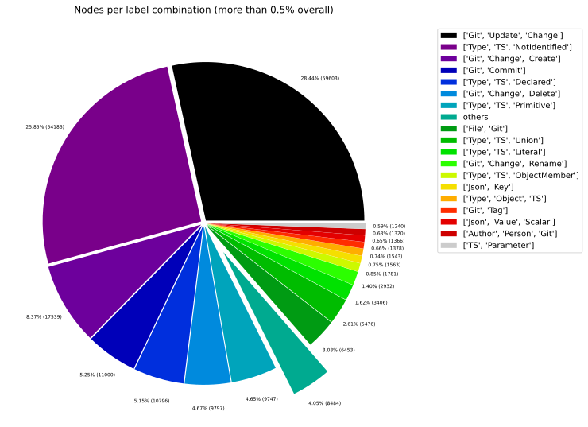
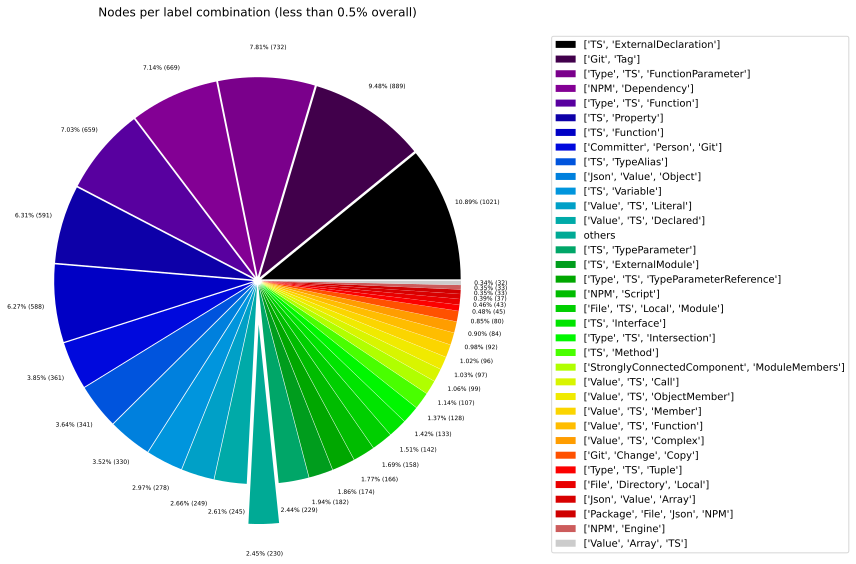
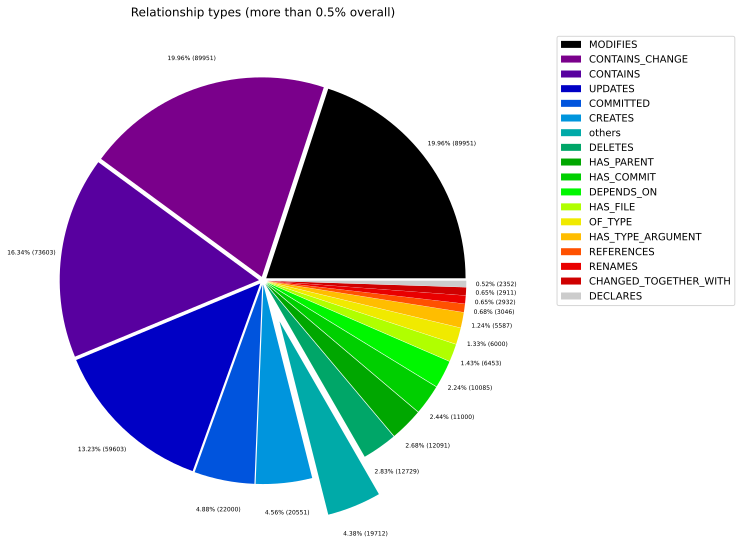
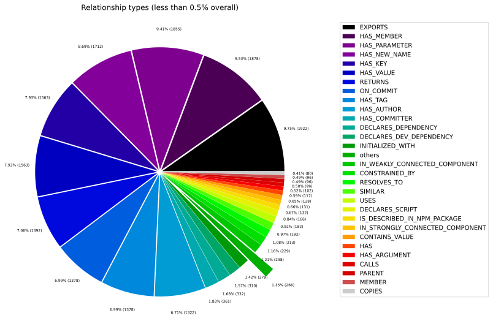
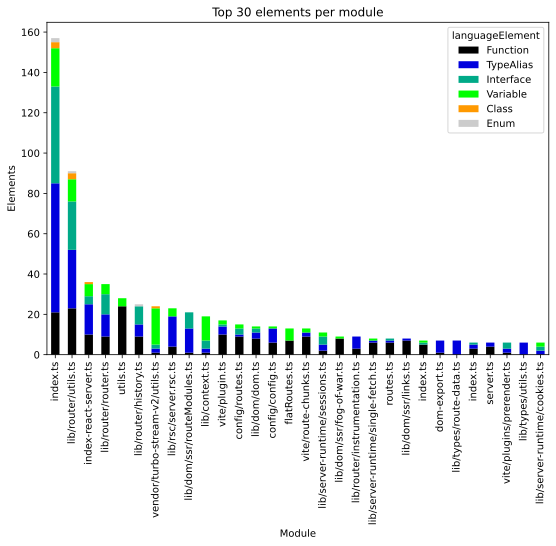
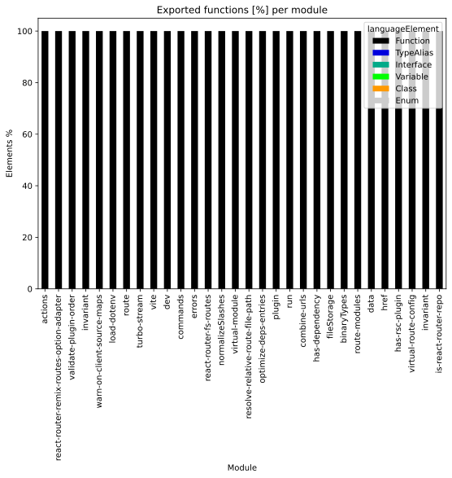
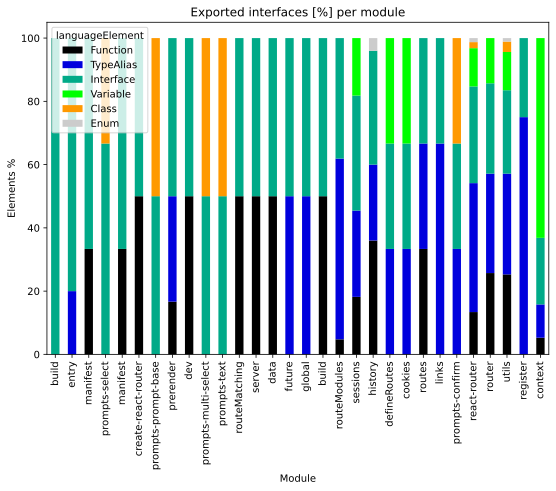
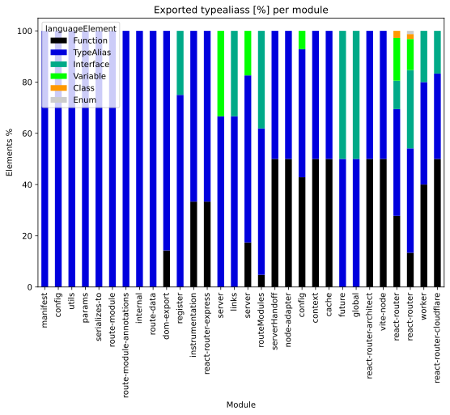
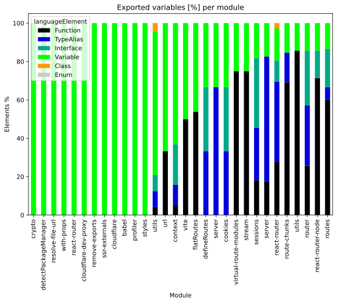

# Overview Report

## 1. Overview

High-level summary of graph database contents: general graph structure (node labels, relationships), Java artifacts, and TypeScript modules.

## 📚 Table of Contents

1. [Overview](#1-overview)
1. [General](#2-general)
1. [Java](#3-java)
1. [TypeScript](#4-typescript)

---

## 2. General

### 2.1 Node label combinations

Shows how many nodes carry each combination of labels and their share of the total node count.

| nodeLabels | nodesWithThatLabels | nodesWithThatLabelsPercent |
| --- | --- | --- |
| ["Git","Update","Change"] | 59603 | 28.43518916082248 |
| ["Type","TS","NotIdentified"] | 54186 | 25.850865893802776 |
| ["Git","Change","Create"] | 17539 | 8.367444301321502 |
| ["Git","Commit"] | 11000 | 5.247841228949 |
| ["Type","TS","Declared"] | 10796 | 5.1505176279757645 |
| ["Git","Change","Delete"] | 9797 | 4.6739182290921235 |
| ["Type","TS","Primitive"] | 9747 | 4.650064405324174 |
| ["File","Git"] | 6453 | 3.078574495491627 |
| ["Type","TS","Union"] | 5476 | 2.612470779065884 |
| ["Type","TS","Literal"] | 3406 | 1.6249224750727542 |

[Full data](./Node_label_combination_count.csv)

---

### 2.2 Node labels

Shows the number of nodes carrying each individual label, sorted by count descending.

| nodeLabel | nodesWithThatLabel | nodesWithThatLabelPercent |
| --- | --- | --- |
| Git | 110465 | 52.70025285053194 |
| TS | 94712 | 45.18486713420161 |
| Change | 89951 | 42.91350603501741 |
| Type | 88678 | 42.306187681885405 |
| Update | 59603 | 28.43518916082248 |
| NotIdentified | 54186 | 25.850865893802776 |
| Create | 17539 | 8.367444301321502 |
| Declared | 11041 | 5.26740136443872 |
| Commit | 11000 | 5.247841228949 |
| Delete | 9797 | 4.6739182290921235 |

[Full data](./Node_label_count.csv)

---

### 2.3 Relationship types

Shows the number of relationships for each type and their share of the total relationship count.

| relationshipType | nodesWithThatRelationshipType | nodesWithThatRelationshipTypePercent |
| --- | --- | --- |
| CONTAINS_CHANGE | 89951 | 19.96439962091367 |
| MODIFIES | 89951 | 19.96439962091367 |
| CONTAINS | 73603 | 16.336001882114804 |
| UPDATES | 59603 | 13.228736874579686 |
| COMMITTED | 22000 | 4.8828450118408995 |
| CREATES | 20551 | 4.561243083561014 |
| DELETES | 12729 | 2.8251697343510367 |
| HAS_PARENT | 12091 | 2.6835672290076507 |
| HAS_COMMIT | 11000 | 2.4414225059204497 |
| DEPENDS_ON | 10085 | 2.238340542927976 |

[Full data](./Relationship_type_count.csv)

---

### 2.4 Node labels and their relationships

Shows which node labels are connected by each relationship type, with count and percentage share.
| sourceLabels | relationshipType | targetLabels | relationshipCount |
| --- | --- | --- | --- |
| ["Git","Commit"] | CONTAINS_CHANGE | ["Git","Update","Change"] | 59603 |
| ["Git","Update","Change"] | MODIFIES | ["Git"] | 59603 |
| ["Git","Update","Change"] | UPDATES | ["Git"] | 59603 |
| ["TS","Union"] | CONTAINS | ["TS","NotIdentified"] | 53911 |
| ["Git","Commit"] | CONTAINS_CHANGE | ["Git","Change","Create"] | 17539 |
| ["Git","Change","Create"] | MODIFIES | ["Git"] | 17539 |
| ["Git","Change","Create"] | CREATES | ["Git"] | 17539 |
| ["Git","Commit"] | HAS_PARENT | ["Git","Commit"] | 12091 |
| ["Repository","Git"] | HAS_COMMIT | ["Git","Commit"] | 11000 |
| ["Author","Person","Git","Committer"] | COMMITTED | ["Git","Commit"] | 11000 |

[Full data](./Node_labels_and_their_relationships.csv)

---

### 2.5 Graph density

Statistical measures of the graph structure: node count, relationship count, and density metric.

---

### 2.6 Dependency node labels

Shows node labels present on dependency nodes — nodes that represent external dependencies not scanned as artifacts.

| sourceLabels | targetLabels | numberOfNodes | percentageOfTotalNodes |
| --- | --- | --- | --- |
| TS,Function | TS,ExternalDeclaration | 1189 | 0.57 |
| TS,Function | TS,Function | 838 | 0.4 |
| TS,Function | TS,ExternalModule | 446 | 0.21 |
| TS,Function | TS,Property | 388 | 0.19 |
| TS,Variable | TS,ExternalDeclaration | 383 | 0.18 |
| TS,Function | TS,Interface | 377 | 0.18 |
| File,TS,Local,Module | TS,ExternalDeclaration | 310 | 0.15 |
| TS,Function | TS,TypeAlias | 309 | 0.15 |
| TS,Function | TS,Variable | 299 | 0.14 |
| StronglyConnectedComponent,ModuleMembers | StronglyConnectedComponent,ModuleMembers | 195 | 0.09 |

[Full data](./Dependency_node_labels.csv)

---

## 3. Java

### 3.1 Artifact size

Overview of scanned Java artifacts: number of packages, types, methods, and lines of code.

> No overview data available.
> Please run the analysis pipeline first to scan and import code artifacts into the graph database (e.g., `analyze.sh`), then start Neo4j and re-run the overview reports.

### 3.2 Java overview charts

---

## 4. TypeScript

### 4.1 Module size

Overview of scanned TypeScript modules: number of exported language elements per module.

| nodeCount | relationshipCount | projectCount | moduleCount | functionCount | objectCount | typeAliasCount | interfaceCount | classCount | methodCount |
| --- | --- | --- | --- | --- | --- | --- | --- | --- | --- |
| 209610 | 450557 | 11 | 160 | 1339 | 1561 | 341 | 142 | 14 | 128 |

[Full data](./Overview_size_for_Typescript.csv)

### 4.2 TypeScript overview charts

